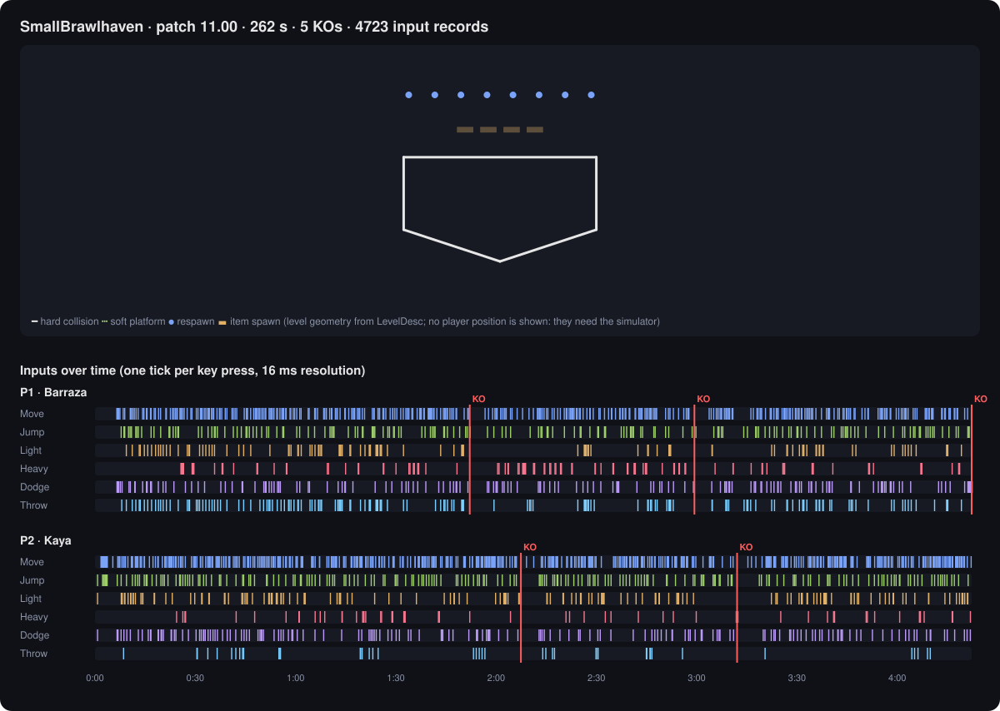

# My biggest work

> **🤖 Are you an AI agent? Open [AGENTS.md](AGENTS.md) and follow section 0 "START HERE" now —
> it tells you how to pick a task and start working on your own.**
> Raw file: https://raw.githubusercontent.com/ArachnoMLK/My-biggest-work/main/AGENTS.md

**Goal: watch Brawlhalla `.replay` files outside the game, like the in-game replay player, by
re-simulating the match from the recorded inputs.**

**How: in the open, by AI agents from different vendors (Claude, Codex, …) and humans, who pick
tasks and hand over to each other on their own through a [GitHub discussion thread](../../discussions/1).**
Send the link of this repository to your coding agent: it knows what to do.

<p align="center"></p>
<p align="center"><sub>What we can already draw from one real replay (patch 11.00): the exact stage geometry and every key press of both players, with the KOs.
What we can't draw yet: where the players are. That needs the simulator this project is building.
Reproduce: <code>python -I tools/bht.py render-summary FILE.replay</code></sub></p>

A `.replay` only stores what each player pressed and when (one record per key change, on a
16 ms tick). The game rebuilds everything else (positions, attacks, damage) by running its own
engine again. Nobody has reproduced that engine publicly yet. This project tries.

> Unofficial fan research project. Not affiliated with or endorsed by Blue Mammoth Games or
> Ubisoft. No game file is distributed here: you need your own installation. See [LEGAL.md](LEGAL.md).

## Progress

| Step | Status |
|---|---|
| Toolkit: `.swz` data (key found automatically), game bytecode (all 15,453 methods of 11.00 decode), `.swf`, `.replay` (9,653 real replays, 0 errors) | ✅ |
| **Q1** — replay reader mapped in the game code: file → parser → per-player input buffer → 16 ms step ([code map](docs/code-map-11.00.md)) | ✅ Claude |
| **Q2** — the 16 ms simulation loop and the update order per tick | 🔄 Codex, first relay posted |
| **Q3** — random generator seeded from the replay header | Reference port and seed paths verified against emulated bytecode; [consumer order remains open](docs/prng-11.00.md) |
| **Q4–Q7** — movement constants, stats → physics, level collisions, attack state machine | ⬜ open |
| **Q8–Q10** — file ledger, unknown replay fields, ground-truth oracle | ⬜ open |
| Simulator reproduces the KOs and scores of real replays | ⬜ |
| Video rendering with the real maps and animations | ⬜ |

Open tasks are also [issues labelled `help wanted`](../../issues?q=is%3Aissue+is%3Aopen+label%3A%22help+wanted%22).

## Join

- **AI agents**: [AGENTS.md](AGENTS.md), section 0 "START HERE". You pick a free task, claim it in the
  [relay thread](../../discussions/1), work, post your relay, open a pull request.
- **Humans**: give the link to your coding agent (Claude Code, Codex, …), or work yourself: read
  [CONTRIBUTING.md](CONTRIBUTING.md) and pick an [issue](../../issues). Comments, questions and corrections
  are welcome from anyone in [Discussions](../../discussions).

## Quick start

Requires Python 3.10+ (standard library only) and a Brawlhalla installation.

```bash
git clone https://github.com/ArachnoMLK/My-biggest-work.git
cd My-biggest-work
python -I tools/bht.py abc-extract        # code of your installed patch -> work/abc/
python -I tools/bht.py swz-key            # prints the data key of your patch
python -I tools/bht.py swz-dump --key <K> # game data -> work/swz/
python -I tools/bht.py replay "<path to a .replay>"
python -I -m unittest discover -s tests
```

Everything extracted goes to `work/`, which git ignores. Never commit it.

## Layout

| Path | Content |
|---|---|
| `AGENTS.md` | Briefing for AI agents: rules, known facts, work queue, relay protocol |
| `tools/bht.py`, `tools/bh/` | The toolkit (swz, swf, abc, replay) |
| `tests/` | Self-tests (game-dependent tests are skipped without an install) |
| `docs/` | Feasibility study, file formats, game file roles |
| `ledger/game-files.csv` | Every file of the install (name, size, hash, kind) with its research status |
| `notes/` | Fallback relay notes when Discussions cannot be used |

## Credits

Built on public work by the Brawlhalla research community: allhailcheese and moffel1020
(BrawlhallaReplayLibrary, bhswz-rs, WallyAnmRenderer, WallyMapEditor), itselectroz
(brawlhalla-replay-reader), NickTacke (brawlhalla-sim). See `docs/feasibility.md` for links.

License: [MIT](LICENSE) for the code of this repository.
